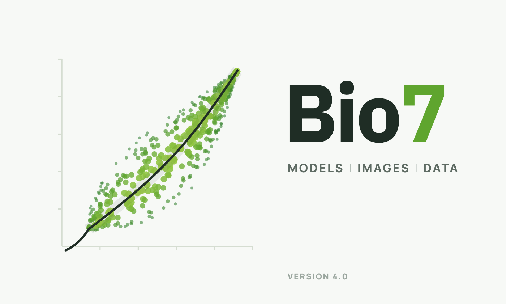

## Bio7

**The scientific workbench for modeling, image analysis and data.**

Bio7 is a free and open-source integrated development environment for ecological modeling, scientific image analysis and statistics. R and Python run embedded in Bio7, ImageJ is part of the workbench, and models, images and data can be exchanged directly between them, the table, the 3D views and the editors. Bio7 is built on the Eclipse Rich Client Platform and runs on Windows, macOS and Linux.

**[Website: bio7.org](https://bio7.org)** · **[Download (releases)](https://github.com/Bio7/bio7/releases)** · **[Manual (HTML)](https://bio7.github.io/bio7documentation/Bio7_Manual.html)** · **[Manual (PDF)](https://github.com/Bio7/bio7documentation/blob/main/Bio7_Manual.pdf)** · **[YouTube channel](https://www.youtube.com/channel/UCFY-w-tMbVzhrLro4Q2KbFg)**

### Documentation

The Bio7 manual describes the perspectives, the editors, the R and Python integration, image analysis, the 3D views and the preferences:

* **[Bio7 Manual (HTML)](https://bio7.github.io/bio7documentation/Bio7_Manual.html)**: to read in the browser
* **[Bio7 Manual (PDF)](https://github.com/Bio7/bio7documentation/blob/main/Bio7_Manual.pdf)**: to read or download ([direct download](https://raw.githubusercontent.com/Bio7/bio7documentation/main/Bio7_Manual.pdf))

The sources of the manual (LyX) are in the repository [bio7documentation](https://github.com/Bio7/bio7documentation).

### Features

**R and Python**
* R and Python (CPython) embedded in the process of Bio7 (Java Foreign Function & Memory API): no server and no extra packages, direct data transfer between R, Python, Java, the table and ImageJ.
* R editor with code completion, code analysis, refactoring and formatting; R Markdown and Quarto documents with inline R and Python chunks; Shiny apps.
* Python editor with code completion, code analysis (ruff), refactoring and a profiler; a Python-Shell view and a package manager.
* Debuggers for R (also class methods of Reference classes, R6 and S7, sourced files, R Markdown chunks) and for Python.
* R-Shell and Python-Shell views to inspect, convert, plot and transfer objects between R, Python and the table.

**Image analysis**
* ImageJ as a native SWT component (SWTImageJ) with detachable image windows.
* Image-Methods and selections with R or Python: image data, selections and ROIs as matrices, data frames, numpy arrays and spatial data.
* Pixel classification with filters, Haralick features and texture operations.

**Data and visualization**
* A fast spreadsheet (table) with transfers to R and Python, import and export of CSV, Excel and LibreOffice files.
* Vector graphics device for R plots, matplotlib and interactive charts (plotly, altair, bokeh, folium) in Bio7.
* 3D views: volume rendering, iso surfaces, 3D measurements of objects (volume, surface area, shape, distances), 3D models and height maps.
* Visualizations and simulations on a 3D globe (WorldWind) and spatial data (GDAL).

**Modeling and development**
* Creation and analysis of simulation models (Java, R, Python).
* Java editor with dynamic compilation, a profiler (Java Flight Recorder) and an installer for Java libraries from Maven Central.
* Scripting with Java, Groovy, BeanShell, JavaScript and ImageJ macros.
* GUIs with the WindowBuilder, also exported as Shiny apps or JavaScript web apps.
* A flowchart editor to combine scripts, macros and compiled code (e.g., for sensitivity analysis).

**Workbench**
* Themes with a theme builder (colors, fonts, icon colors, artwork), light and dark.
* An LLM assistant for OpenAI-compatible servers (also local ones).

### Installation

Download Bio7 for Windows, macOS (Apple Silicon) or Linux from the [releases](https://github.com/Bio7/bio7/releases). Bio7 includes its Java runtime. Install [R](https://cran.r-project.org/) and, optionally, [Python](https://www.python.org/).

### Build Bio7

Bio7 is built with Maven and Eclipse Tycho; all plugins and features are in this repository. See the wiki: [How to build Bio7](https://github.com/Bio7/bio7/wiki/How-to-built-Bio7).

### License

Bio7 is licensed under the [Eclipse Public License 2.0](https://www.eclipse.org/legal/epl-2.0/).
